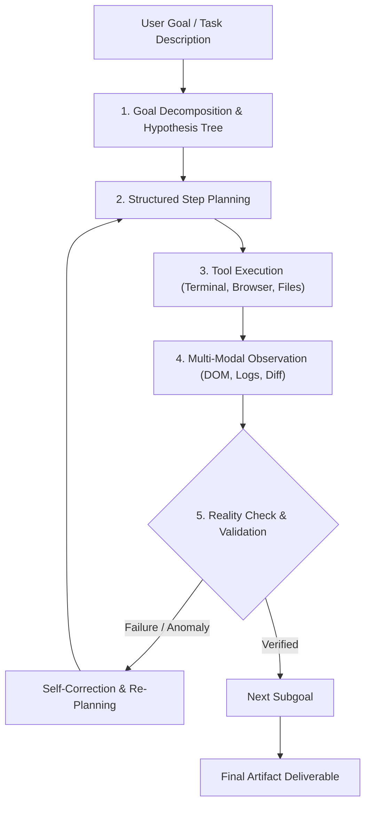

# Manus Agent: Autonomous Execution Loop & Multi-Agent Agency Suite

Manus (`manus.im` & `FoundationAgents/OpenManus`) is an autonomous AI agent architecture designed to solve complex end-to-end goals without human intervention. Instead of single-turn question answering, Manus operates through an **autonomous perception-planning-action loop**, self-reflection, sandboxed terminal tools, and specialized multi-agent roles.

## The Core Autonomous Loop



---

## Included Agency Skills (`agency/`)

| Skill Role | Focus Area | Core Responsibilities |
|:---|:---|:---|
| **`agency-design-ui-designer`** | Visual Design & Tokens | High-contrast monospace, dark studio surfaces, micro-spacing, typography scales |
| **`agency-design-ux-architect`** | Information Architecture | User journey trees, cognitive load optimization, friction elimination |
| **`agency-design-brand-guardian`** | Brand Identity & Tone | Strict brand guidelines, color palettes, visual voice alignment |
| **`agency-design-whimsy-injector`** | Micro-Delight | Tactile physical feedback, easter eggs, physics micro-interactions |
| **`agency-engineering-frontend-developer`** | Frontend Engineering | React 19, Next.js, Tailwind v4, accessible Base UI primitives |
| **`agency-engineering-senior-developer`** | Core Architecture | Clean contracts, error boundaries, memory leak prevention, async stability |
| **`agency-engineering-rapid-prototyper`** | High-Velocity MVP | Functional end-to-end prototypes within minutes, zero friction |
| **`agency-specialized-agents-orchestrator`** | Multi-Agent Coordination | Task delegation, dependency management between agents, consensus |
| **`agency-testing-reality-checker`** | Anti-Hallucination & QA | Rigorous output validation against real DOM, API returns, and tests |

---

## Manus UI Visual System

The Manus agent interface uses an ultra-clean, technical, high-density aesthetic:
- **Backgrounds:** `#08080a` (Deep Space Obsidian), `#0e0f13` (Component Bay), `#121318` (Header Strip)
- **Accents:** Emerald `#10b981` (Completed / Active Pulse), Amber `#f59e0b` (Running / Tool Execution), Rose `#f43f5e` (Error / Retrying)
- **Typography:** Strict Monospace (`JetBrains Mono`, `Fira Code`, `Geist Mono`) for telemetry and step logs.

### Included React Component: `ManusThoughtTree`

```tsx
import { ManusThoughtTree } from './components/ManusThoughtTree';

const steps = [
  {
    id: '1',
    type: 'plan',
    title: 'Analyze market competitors and site DNA',
    status: 'completed',
    content: 'Extracted tokens and typography from 5 benchmark luxury sites.',
    durationMs: 340,
  },
  {
    id: '2',
    type: 'tool',
    title: 'Execute browser scraper & DOM extraction',
    status: 'completed',
    content: 'Parsed layout grid and color variables.',
    durationMs: 1200,
  },
  {
    id: '3',
    type: 'observe',
    title: 'Verify visual contrast & typography hierarchy',
    status: 'running',
  },
];

export function AgentConsole() {
  return <ManusThoughtTree steps={steps} isExecuting={true} />;
}
```

---

## File Structure

- `agency/`: 9 Fully documented Manus agency skills (`agency-design-ui-designer`, `agency-design-ux-architect`, `agency-engineering-senior-developer`, etc.)
- `components/`: `ManusThoughtTree.tsx` for displaying autonomous agent step logs, duration telemetry, and collapsible thought traces.
