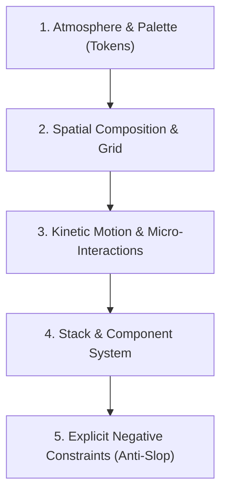

# SiteReel Vibe: The Vibe Coding & Motion Reel Engine

SiteReel (`sitereel.ai`) is the inspiration and prompt platform for **"Vibe Coding"**—the paradigm where developers steer AI coding agents (Manus, Claude Code, Cursor) using natural language, structured aesthetic contracts, and motion directives rather than manually writing repetitive boilerplate.

This skill equips AI agents with the exact prompt structures, aesthetic blueprints, and anti-slop guidelines used by top-tier SiteReel creators to produce Awwwards-caliber, motion-heavy websites.

---

## 🏛️ The SiteReel Vibe Prompt Architecture

Every high-performing vibe prompt consists of **5 structural layers**:



### Layer 1: Atmosphere & Color Identity
- Never use generic `#ffffff` or `#000000`. Specify nuanced neutrals:
  - **Obsidian Dark:** `#090a0f` base, `#12141c` elevated cards, `#1c1f2b` borders.
  - **Warm Editorial:** `#f9f6f0` base, `#ece6d8` cards, `#2a2723` typography.
  - **Titanium Luxury:** `#0c0d11` base, `#181a22` brushed metal panels, `#d4af37` gold accents.

### Layer 2: Spatial Composition
- **Asymmetrical Bento Grids:** 1 wide feature card (span 2), 2 vertical stacked telemetry cards, 1 square interactive widget.
- **Floating Island Navigation:** Fixed top or bottom pill nav with `backdrop-blur-md`, subtle border, and integrated status beacon.
- **Hero Split:** 55% typography & value proposition, 45% interactive craft widget (not a static stock image).

### Layer 3: Kinetic Motion & Physics
- **Entrance Easing:** `cubic-bezier(0.16, 1, 0.3, 1)` (spring-like natural deceleration).
- **Interactive Triggers:** Magnetic button pull on cursor proximity, smooth hover card elevation (`-translate-y-1`), and running border trails.
- **Kinetic Typography:** Rolling odometer digit tickers, split-flap letter reveals, or subtle cipher text descrambling.

### Layer 4: Explicit Negative Constraints (Anti-AI-Slop)
- ❌ **No generic 3D particle mesh blobs** (they look pixelated and outdated).
- ❌ **No purple-to-pink gradient blur circles on black** (AI template hallmark).
- ❌ **No unstyled HTML form inputs or buttons**.
- ❌ **No generic icon-in-a-colored-box feature lists**.
- ❌ **No placeholder lorem ipsum text**; write realistic domain copy.

---

## 🎨 Curated Vibe Recipes

### Recipe 1: Luxury Atelier & Haute Horlogerie
```markdown
Create a luxury boutique landing page for a bespoke mechanical watch atelier.
- Atmosphere: Deep Obsidian (#08080a) with brushed titanium panels (#14161f) and champagne gold accents (#d4af37).
- Typography: Display serif (Cinzel / Cormorant) paired with high-precision monospace (Geist Mono).
- Hero: Left side carries a bold editorial headline with subtle letter-spacing; right side features an interactive mechanical dial with real-time anisotropic reflection highlights.
- Micro-interactions: Magnetic cursor pull on primary CTA, subtle ticking sounds on dial scrub, smooth progressive backdrop blur.
- Stack: React, Tailwind CSS, Framer Motion, and Base UI primitives.
```

### Recipe 2: Hyper-SaaS & Developer Infrastructure
```markdown
Create a dark-tech developer platform landing page for an edge compute network.
- Atmosphere: Carbon slate (#0b0c10) with emerald status beacons (#10b981) and cobalt borders.
- Layout: Asymmetrical bento grid showcasing real-time request latencies, an interactive code terminal with syntax highlighting, and a global edge map.
- Motion: Rolling odometer digits for requests-per-second, border-trail beam racing around the active pricing card, expandable command palette.
- Stack: Next.js 16, Tailwind CSS v4, Lucide icons, and Motion primitives.
```

---

## 🚀 Converting a Vibe Prompt to Production Code

When executing a vibe prompt:
1. Initialize design tokens in CSS variables (`--bg`, `--card`, `--border`, `--accent`).
2. Scaffold semantic layout (`header`, `main`, `section`, `footer`).
3. Embed tactile craft components from `tactile-hardware-ui`, `craft-interactions`, `kokonut-ui`, and `motion-primitives`.
4. Run live verification with realistic domain data and zero pixelated assets.
